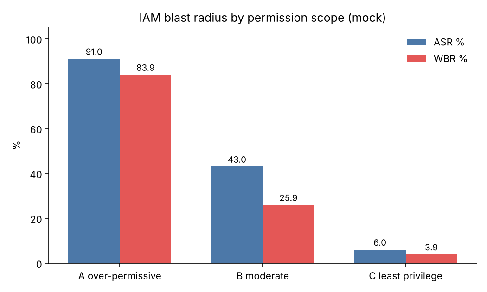
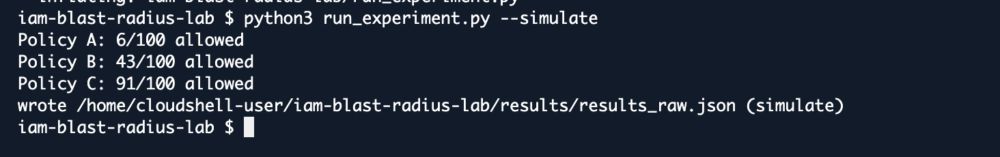
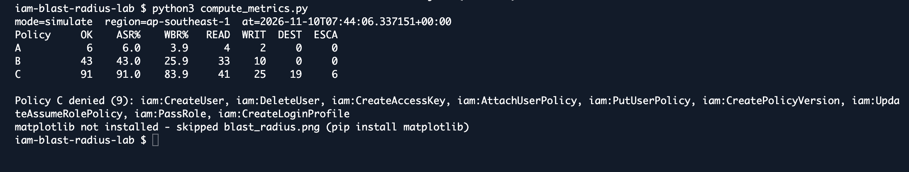

# IAM Blast-Radius Lab

Phase 1 of [AI-Enhanced Attacks on Cloud Infrastructure](https://github.com/olafier/ai-enhanced-attacks-cloud).
Measuring how IAM permission scope changes the **blast radius** of a compromised cloud
identity, using a fixed set of 100 AWS actions and a weighted severity metric.

> **Research question:** How does IAM permission scope affect the blast radius of a
> compromised cloud identity?

## Method

- **Independent variable:** IAM permission scope — three policies.
- **Dependent variable:** blast radius = how many actions succeed, weighted by severity.
- **Controlled:** the same **fixed set of 100 actions** across **12 services**, evaluated
  identically for every identity.

### Fixed action set (100 actions, 12 services)

| | |
|---|---|
| Services | S3, EC2, IAM, STS, Lambda, DynamoDB, KMS, CloudTrail, CloudWatch Logs, Secrets Manager, SSM, RDS |
| Categories | READ 41 · WRITE 26 · DESTROY 20 · ESCALATE 13 (total weight 205) |

### Policies (report convention)

- **A — over-permissive (PowerUser-like):** `s3:* ec2:* lambda:* dynamodb:* kms:* cloudtrail:* logs:* secretsmanager:* ssm:* rds:* sts:*` + `iam:List*/Get*` (no IAM mutation).
- **B — moderate (operational):** broad read + operational writes; no delete, no IAM, no escalation.
- **C — least privilege:** read one S3 bucket, write own log stream, `sts:GetCallerIdentity`.

### Metrics (weights fixed before the run)

- **ASR** (Action Success Rate) = allowed / total × 100
- **WBR** (Weighted Blast Radius) = Σ weight(allowed) / 205 × 100, with
  READ = 1, WRITE = 2, DESTROY = 3, ESCALATE = 4.

## Results — real AWS IAM Policy Simulator

Run in AWS CloudShell (`ap-southeast-1`) via `iam:SimulateCustomPolicy`. The local
`--mock` evaluator reproduces these decisions exactly (100/100 per policy). These are
**permission-scope** results — "allowed" means permitted by policy, not executed. The
behavioral run (CloudTrail as the instrument) is the next pass.

| Policy | OK | ASR | WBR | READ | WRITE | DESTROY | ESCALATE |
|---|---|---|---|---|---|---|---|
| A over-permissive | 91 | 91.0% | 83.9% | 41/41 | 25/26 | 19/20 | 6/13 |
| B moderate | 43 | 43.0% | 25.9% | 33/41 | 10/26 | 0/20 | 0/13 |
| C least privilege | 6 | 6.0% | 3.9% | 4/41 | 2/26 | 0/20 | 0/13 |



### Findings

1. **Blast radius grows non-linearly with scope.** Least privilege → moderate raises ASR
   by 37 points but WBR by only 22 (moderate gains READ/WRITE only). Moderate →
   over-permissive raises WBR by 58 points because DESTROY and ESCALATE open up.
2. **The ASR − WBR gap encodes severity.** Moderate succeeds at 43% of actions but only
   25.9% weighted — it holds nothing destructive. For over-permissive the gap narrows
   (91 vs 83.9).
3. **"No `iam:*`" ≠ "cannot escalate."** The over-permissive policy is denied all 9 IAM
   identity-mutation actions, yet still reaches **6 of 13** escalation actions through
   resource policies and execution paths: `s3:PutBucketPolicy`, `kms:PutKeyPolicy`,
   `secretsmanager:PutResourcePolicy`, `ec2:AssociateIamInstanceProfile`, `sts:AssumeRole`,
   `ssm:SendCommand`. This is the mechanism behind UNC6426's "overly permissive" role.

### Limitations

The simulator evaluates **identity policies only** — not SCPs, permission boundaries,
target-side resource policies, condition keys, or the trust policy of a role being assumed.
"Allowed" means *permitted by policy*, not a real API call.

## Proof of run

Real CloudShell session:

| `--simulate` output | metrics |
|---|---|
|  |  |

> Note: these shots were captured during the original run, when the **narrow** policy was
> labelled A. The repo now follows the report convention (**A = over-permissive,
> C = least privilege**), so the per-letter figures in the screenshots are mirrored
> (narrow = 6, moderate = 43, broad = 91). The numbers are unchanged — only the A/C labels
> were realigned afterwards.

## Run it

```bash
python3 run_experiment.py --mock        # local, no AWS
python3 run_experiment.py --simulate    # real IAM Policy Simulator — free, creates no resources
python3 compute_metrics.py              # -> results/metrics.csv, results_detail.csv, blast_radius.png
```

In AWS CloudShell: upload the repo, then
`python3 run_experiment.py --simulate && python3 compute_metrics.py`.

## Experiment 2 — on a real EC2 instance (optional)

Deploys roles A/B/C on a `t3.micro` (free tier) and measures blast radius from the box —
the credentials an attacker would pull from Instance Metadata. It proves the stolen
credentials are live with **read-only** calls, probes the write tier with a **non-mutating
EC2 DryRun**, and measures the rest with `SimulatePrincipalPolicy`. **It runs no
write / delete / privilege-escalation action.** This is the bridge toward the behavioral
(CloudTrail) pass.

```bash
bash setup_lab.sh                 # create roles + t3.micro (prints ssh/scp commands)
ssh -i ~/blast-lab-key.pem ec2-user@<PUBIP> 'python3 vm_live_read.py'
python3 measure_principal.py      # effective perms of each role + diff vs the simulator
bash teardown_lab.sh              # ALWAYS run this when done
```

Everything stays in free tier; no KMS key, secret, or RDS instance is ever created. Use a
sandbox account only.

## Files

```
action_set.py        100 actions + service + category + weight
run_experiment.py    --mock | --simulate  -> results/results_raw.json
compute_metrics.py   ASR / WBR + chart
policies/            policy_A_broad.json, policy_B_moderate.json, policy_C_narrow.json
setup_lab.sh         Exp 2: create roles + EC2
vm_live_read.py      Exp 2: live read-only probe on the instance
measure_principal.py Exp 2: effective-permission measurement
teardown_lab.sh      Exp 2: delete everything
runner-policy.json   minimal policy (iam:SimulateCustomPolicy + sts:GetCallerIdentity)
results/             results_raw.json, metrics.csv, results_detail.csv, blast_radius.png
images/              CloudShell run screenshots
```
